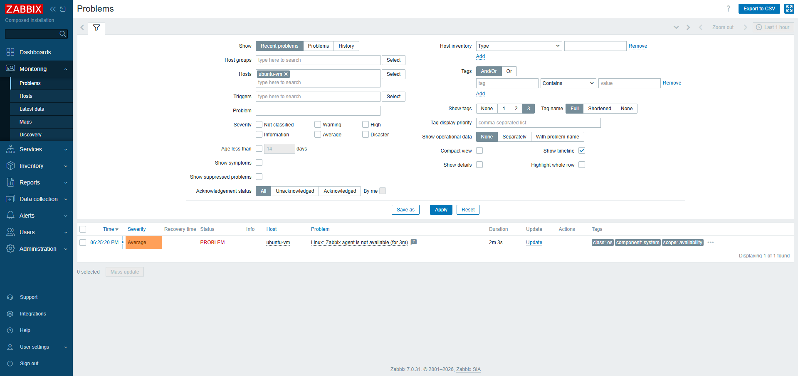
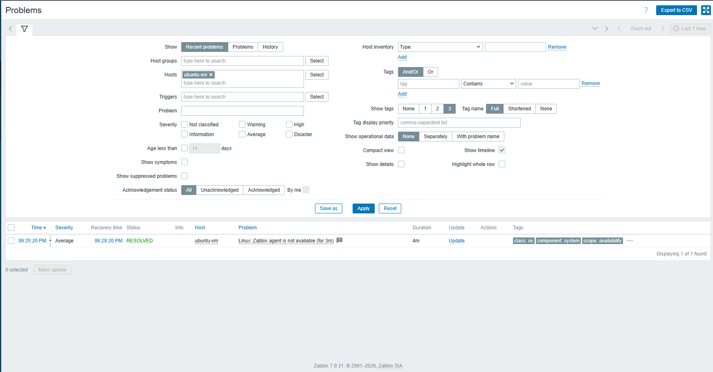

# zabbix-lab

Ambiente de monitoramento com **Zabbix 7.0 em Docker**, monitorando uma **VM Linux via agente** e disparando alertas de indisponibilidade.

Projeto de estudo, feito do zero para aprender monitoramento de infraestrutura na prática.

## Arquitetura

```
   WSL (Windows)                           VirtualBox (rede bridge)
┌─────────────────────────┐             ┌──────────────────────────┐
│ Docker Compose          │   porta     │ VM Ubuntu Server         │
│  ├─ MySQL               │   10050     │  └─ Zabbix Agent 7.0     │
│  ├─ Zabbix Server  ─────┼────────────▶│     (modo passivo)       │
│  └─ Interface web (Nginx)│            └──────────────────────────┘
└─────────────────────────┘
        ▲
        └── http://localhost
```

| Componente | Onde roda | Função |
|---|---|---|
| MySQL | Docker (WSL) | Guarda configuração e histórico de métricas. Não é exposto ao host. |
| Zabbix Server | Docker (WSL) | Coleta dados, avalia triggers. Porta 10051 publicada. |
| Interface web | Docker (WSL) | Painel de gerenciamento (Nginx). |
| Zabbix Agent | VM Ubuntu Server | Responde ao servidor na porta 10050. |

O host `ubuntu-vm` usa o template **Linux by Zabbix agent** em **modo passivo**: o servidor consulta o agente.

## Como reproduzir

1. Clone o repositório oficial (branch 7.0) e suba o ambiente:
```bash
   git clone -b 7.0 https://github.com/zabbix/zabbix-docker.git
   cd zabbix-docker
   docker compose -f ./compose.yaml up -d
   docker compose ps
```
2. Acesse `http://localhost` e troque a senha padrão do usuário `Admin`.
3. Em uma VM Linux (rede em bridge), instale o `zabbix-agent` e configure o parâmetro `Server=` com o IP do servidor.
4. Em *Data collection → Hosts*, cadastre o host com o template **Linux by Zabbix agent** e confira se o ZBX fica verde.

## Teste de alerta

Para validar o monitoramento, parei o agente na VM:

```bash
sudo systemctl stop zabbix-agent
```

Ao parar o agente, a porta 10050 da VM deixou de responder. O servidor, no modo passivo, continuou consultando o agente a cada minuto e não recebeu resposta. Após 3 minutos sem dados, a trigger do template disparou o problema **"Zabbix agent is not available"**, visível em *Monitoring → Problems*.

Ao religar o agente (`sudo systemctl start zabbix-agent`), o servidor voltou a receber dados e o problema foi marcado como **RESOLVED**, com 4 minutos de duração.




O reinício da VM também gerou alertas do template ("host has been restarted" e "Load average is too high"), mostrando que o Zabbix detecta o reboot e o pico de CPU do boot.

## Problemas encontrados e soluções

| Problema | Causa | Solução |
|---|---|---|
| `dpkg`/`apt` negavam acesso | Faltava permissão de administrador | Usar `sudo` |
| `docker compose` não encontrado | Plugin não instalado | Instalar o pacote `docker-compose-v2` |
| Servidor e frontend instalados na VM por engano | Pacotes instalados junto com o agente | `apt remove --purge` e conferência com `ss -tlnp` |
| VM não alcançava o servidor no WSL | A rede NAT do VirtualBox isola a VM | Trocar para **bridge**, usando a placa de rede física (não a da VPN) |
| `git push` pedia senha e faltava identidade | Git sem configuração | Configurar nome/e-mail e autenticar com `gh auth login` |

## O que aprendi

- **Container x VM:** containers compartilham o kernel do host e são leves. VMs têm sistema operacional próprio.
- **Modo passivo x ativo:** no passivo, o servidor consulta o agente (porta 10050). No ativo, o agente envia os dados ao servidor (porta 10051).
- **Expor só o necessário:** o banco não publica a 3306, só o servidor Zabbix acessa. A 10051 é publicada porque agentes precisam alcançar o servidor.
- **Triggers esperam antes de disparar:** evita alarmes falsos por oscilações curtas de rede.

## Próximos passos

- [ ] Item personalizado via script: contar tentativas falhas de login SSH (`/var/log/auth.log`) e enviar ao Zabbix
- [ ] Dashboard no Grafana

## Segurança

Este repositório é público. `.env`, `zbx_env/` e senhas **não** são versionados (ver `.gitignore`).

## Licença

MIT
